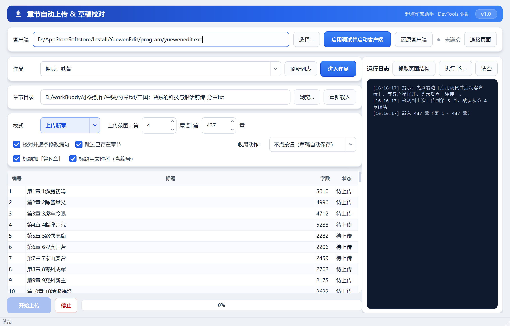
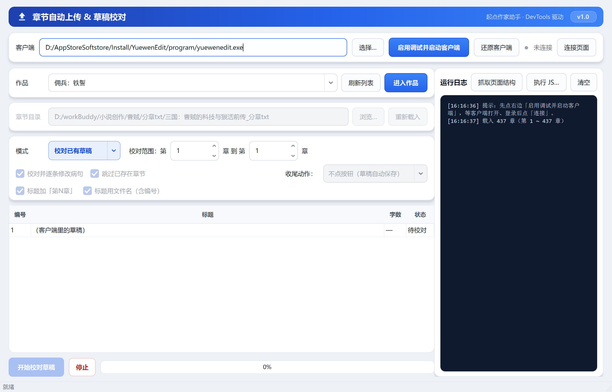

# ChapterUploader — 起点作家助手章节自动上传

配套「阅文·作家助手」（`yuewenedit.exe`）的分章批量上传工具：从本地分章 txt 目录逐章
**新建章 → 填标题 → 贴正文 → 校对检测 → 逐条改病句 → 下一章**，中途可停，支持指定章节区间。

---

## 界面预览

**上传新章**（左侧选作品、章节目录、区间；右侧是章节表与实时日志）



**校对已有草稿**（不动标题正文，逐章跑「错别字 → 病句」并改建议）



---

## 为什么要走 DevTools 协议

先说结论：**不能用 QtWebEngine 内嵌这个后台**。

| 方案 | 结果 |
|---|---|
| QtWebEngine 内嵌网页 | ❌ MinGW 版 Qt 6.8.3 没有 `qtwebengine` 模块（只有 MSVC 版），本机也没装 VS；而且你用的是**客户端**不是网页，嵌不进去 |
| 纯键鼠模拟（坐标点击） | ⚠️ 能做「新建章 + Ctrl+V」，但第 4 步要**一处处点红线弹窗里的替换**，坐标法必崩 |
| **CDP（DevTools 协议）** | ✅ 客户端是 Electron，给主进程加一个调试端口开关后，可以像在控制台里执行 JS 一样精确操作 DOM |

客户端装在 `D:\AppStoreSoftstore\Install\YuewenEdit\program`，是 Electron + Vue + TinyMCE。

### 补丁做了什么

只改客户端一个入口，不动 asar 本体：

```
resources/app/package.json       main: "./loader.asar/main.js"  →  "./cdp-main.js"（原文件备份为 package.json.ywbak）
resources/app/cdp-main.js        新增：appendSwitch('remote-debugging-port','9222') 后 require 原 loader
```

随时点界面上的「还原客户端」即可恢复。

---

## 用到的页面结构（来自客户端 5.24.0 的渲染代码）

| 目标 | 选择器 |
|---|---|
| 书架作品卡片 | `.book_list .item_container[data-book-id]`；书名在 `.book_title` 或封面 `img[alt]` |
| 开书 | 优先 `window.browserWindowAPI.openBook({CBID})`（客户端预加载脚本的 IPC，`window:openBook`）；拿不到才退回点封面 |
| 写作页判定 | 存在 `#chapter-title`，或 hash 含 `#/chapter/`（客户端把它开在独立的 `write.html` 窗口里） |
| 侧栏章节条 | `[id^="chapter_"]`，文本形如 `第172章 172西走定荆`（**要排掉容器 `#chapter_list`**，它 id 也以 `chapter_` 开头且包含全部条目文字） |
| 分卷节点 | 侧栏是「分卷 → 章节」两级树：分卷是原生 `<details id="volume_…">`，卷里章节**只有点开 `<summary class="volume-info">` 才会被渲染**。第二卷之后默认收起，只滚列表永远找不到卷内章节 |
| 章节全量目录 | Pinia：`#app.__vue_app__.config.globalProperties.$pinia.state.value.chapterStore.ChapterState.list`，是分卷数组，每卷 `chapters[]` 里带 `CCID/CBID/chaptertitle/actualwords`。**这才是权威目录**，不受侧栏展开/虚拟滚动影响 |
| 跳章 | 侧栏条目的 `href` 就是 `#/chapter/<CBID>/<CCID>`，直接改 `location.hash` 即可切章（和点条目等效，`chapterStore.currentChapter` 会同步更新）。本工具草稿模式就用它跳章 |
| 侧栏滚动容器 | 侧栏是 ant-design **虚拟树**，真正滚的是 `.ant-tree-list-holder`（`#chapter_list` 自己不滚）；可见区只渲染十几条，按章节号跳转要先滚过去 |
| 新建章 | 侧栏 `.action-btn`，文本 `新建章`（**插在当前选中章之后**） |
| 标题 | `<textarea id="chapter-title">`（侧栏写作页里是 `.side-editor-box #chapter-title`） |
| 正文 | TinyMCE：先把焦点挪进正文区（`focusBody()`），再 `setContent(html)`。**必须聚焦**，否则 `tinymce.activeEditor` 可能还挂在上一章的编辑器上，写进去页面上看不见 |
| 校对入口 | 右栏 `.menu-item`，文本 `校对` |
| 检测按钮 | 校对面板里有**两块独立检测**：`错别字` 和 `病句`，各自一个「检测」按钮（同一个 `button.check.dscheck` 样式）。必须按面板顺序两块都点，只点第一个 `querySelector` 拿到的等于只做了错别字 |
| 错别字列表 | `ul.correc-list > li.correc-item`，条目里 `button#check_modify_<idx>.btn.primary`（「修改」） |
| 病句红线 | 正文里的红线**不是列表按钮**，而是自定义元素 `<el-word data-grammaridx=… data-origin-word="原句" data-correct-word="建议句">` 包着 `<span class="grammar-mark">`。条目里只有「忽略」，**没有「修改」按钮** |
| 病句改法 | `#editor-body` 上挂的是 `mouseover`：把鼠标移到 `el-word` 上才弹出 `.context-menu.correc-context.grammar-context`，框里 `.context-primary > label` 就是蓝色的建议句，`label.click()` 才会真正替换正文并抹掉这条红线 |
| 一键全改 | `button.modify-all`（本工具默认逐条点，便于控制） |
| 结果状态 | 每块自己的小标题：`错别字：检测完成` / `病句：未检测`（识别方式：找文字里只含「错别字」或只含「病句」的叶子节点，把它和最近的「检测」按钮配对） |

---

## 上传流程（工具内部按这个顺序走）

1. **确认在写作页**：连上后先判断当前 target 是书架首页还是写作页（`write.html#/chapter/…`）。
   - 已在写作页，且标题框与章节侧栏都渲染完 → 直接开始；
   - 还在书架 → 用「作品」里的书名/CBID 调 `browserWindowAPI.openBook({CBID})` 直接开书（不依赖封面有没有渲染出来），然后轮询 `/json/list` 等写作页 target 出现，自动切过去。
2. **选中上一章**：客户端「新建章」是**插在当前选中章节之后**，所以每个章节都会先点中侧栏的第 `N-1` 章，并等标题框真的切到那一章再继续。
3. **跳过已存在章节**：按 `chapterStore` 的全量目录判断「第 N 章」是否已存在（收起分卷里的也算），默认勾选，防止重跑生成重复章。
   - **只有正文非空（`actualwords > 0`）才算已存在**。客户端里经常有「第243章」这种只建了壳、0 字、标题只有编号的空占位章，
     它们不算已上传；遇到这种章会**原地填充**（跳过去 → 写标题 → 写正文），不再点「新建章」——
     因为「新建章」是插在当前章之后，会把那条空章顶下去，结果多出一条空章。
4. 新建章 → 填标题（填完强制失焦，让客户端提交标题）→ **聚焦正文区** → 贴正文 → 字数校验（顺便复核标题有没有被客户端刷掉）→ 校对 →
   **错别字检测 → 把错别字改完 → 病句检测 → 把病句改完 → 收尾 → 下一章**。
   - 顺序是「一块检测完就立刻改这一块」：改字会改变下一块检测的结果，也让每块的结果不会被拖到后面。
   - 病灶在正文里的红线 `<el-word>` 上：滚到红线 → 派发 `mouseover` 唤出修改框 → 点框里那条蓝字建议 → 复核红线少一条。
   - 错别字（`data-dsidx`）和病句（`data-grammaridx`）走同一套；改不动的不会死等：修改框没建议就按 `data-correct-word` 直接替换，连替换都不行就点「忽略」抹掉红线，继续下一条。

---

## 首次使用（必须按顺序）

1. **完全退出作家助手**（关窗口不够，托盘图标右键退出；客户端是单实例的，它还在跑就没法带调试端口重启）。
2. 打开本程序，确认顶部「客户端」路径对（默认会自动找到 `yuewenedit.exe`）。
3. 点 **「启用调试并启动客户端」** → 会提示要写两个文件，确认后启动。
4. 在客户端里**登录**就行，不用手动进书。程序会自动尝试连接 60 秒，连上后右上角圆点变绿。
5. 左上角「作品」里填书名（或先点「刷新列表」从书架里选），再点 **「进入作品」**——程序会自己在客户端里点开这本书，切到它的写作页。
6. 选模式：
   - **上传新章**：选章节目录 → 设区间 → 点「开始上传」。
   - **校对已有草稿**：区间填「第 1 章到第 150 章」→ 点「开始校对草稿」。

> 「作品」留空时，上传开始会按章节目录名推导书名（`三国：曹贼的科技与狠活前传_分章txt` → `三国：曹贼的科技与狠活前传`）。

> 如果圆点一直灰着：客户端里刷新一下页面，或手动点「连接页面」。

---

## 界面说明

- **模式**（左上第一个下拉）：
  - `上传新章`：从本地分章 txt 新建章节、写标题正文，再校对。
  - `校对已有草稿`：**不动标题和正文**，把客户端里已有的章节逐章切过去，只跑「错别字 → 病句」检测并把建议逐条改掉，改完自动下一章。区间直接填「第 1 章到第 150 章」，不需要章节目录（该行会变灰）。
    草稿模式不点保存/发布（客户端自己会存）。
    - 切章不是靠点侧栏条目的：客户端侧栏是「分卷 → 章节」两级虚拟树，第二卷之后的分卷默认**收起**，卷里章节根本没进 DOM，硬滚列表是找不到的。
    - 现在改成读 Pinia 里的 `chapterStore.ChapterState.list`（全量目录，每章带 `CCID/CBID`），直接 `location.hash = '#/chapter/<CBID>/<CCID>'` 跳章：实测第 151/152/300/449/700/1200 章都在 15~300ms 内命中，和点侧栏条目等效（`chapterStore.currentChapter` 会同步更新）。跳完仍由 `draftReady` 复核标题和字数，确认正文真的换了才继续。
    - 万一某个客户端版本读不到这个 store，脚本会退回老办法：先把所有分卷展开（收起 → 卷头聚到列表末尾 → 一次点开），再滚虚拟列表按章号逼近；两条路都不通才报失败，失败信息会带上「目录共 N 章，第 a~b 章」。
- **上传/校对范围**：按章节编号，包含两端；上传模式下有进度记录时会自动从「上次的下一章」开始。
- **作品（书名）**：左侧最上方，可直接手输，也可点「刷新列表」从客户端书架里选（当前不在书架页时会自动切过去读，读完切回写作页）。下拉项里带着作品的 CBID，开书走客户端自己的 `openBook` IPC，不再依赖封面图是否渲染。
  - **进入作品**：在客户端里点开这本书并切到写作页；已连接就直接进，没连接会先连上再进。
  - 书名会记住，下次打开程序还在。留空 = 上传时按目录名推导 / 点书架第一本。
- **跳过已存在章节**：侧栏里已有「第 N 章」**且正文不为空**才跳过，重跑不会生成重复章（想强制重传就取消勾选）。只有编号、0 字的空占位章会被原地填上内容，不会跳过、也不会多建一条空章。
- **校对并逐条修改病句**：勾上就跑第 3、4 步；不勾只做新建+填充。
- **标题加「第N章」/ 标题用文件名**：默认都勾，得到 `第170章 170白衣拜将`（和客户端里现有章节一致）。只勾前者是 `第170章 白衣拜将`。
- **收尾动作**：默认**不点任何按钮**（客户端每 60 秒自动存草稿，最安全）；也可选让它点「保存」或「发布」。
- **抓取页面结构**：连上后点它，会把当前页面的按钮文案、可编辑元素坐标、HTML 片段存到 `debug/page-*.json`，用来在页面改版后校准选择器。
- **执行 JS…**：连上后可在页面里跑任意表达式，排查用。

### 外观

样式全在 `theme.qss`（经 `app.qrc` 打进 exe 的资源 `:/theme.qss`），`main.cpp` 里设 Fusion + 浅色 QPalette。

- **品牌头**：窗口顶部一条蓝色渐变条（`appHeader` + `appTitle` / `appSub` / `verChip`），左侧白色上传标记 + 标题，右侧副标题与版本号；纯装饰，不带任何逻辑。
- **应用图标**：`icons/app.png`（任务栏/标题栏），头部用的是同形状的白色版 `icons/app-mark.png`；`setWindowIcon` 在 `MainWindow` 构造里设置。
- **卡片投影**：QSS 画不了阴影，构造里用 `QGraphicsDropShadowEffect` 给所有 `objectName=card` 的 `QFrame` 加投影（只影响绘制）。
- **字段标签固定宽 60px**（`fieldLabel()`）：「作品」「章节目录」「模式」的输入区左边缘因此对齐；选项区拆成三行（模式+范围 / 校对+跳过+收尾 / 标题选项），否则第一行会把「校对并逐条修改病句」压断。
- 下拉框、自旋框、复选框的箭头/勾都换成了 `icons/*.svg` 里的自绘图标（QSS 用 `image: url(:/icons/…)`）：默认 Fusion 的小三角太淡，看不出那是能点的控件。
- 左上「模式」下拉挂 `objectName=modeCombo`，QSS 里是蓝底强调样式 —— 它是整个工具最关键的开关，不能跟普通输入框一个长相。
- 改图标要同时改 `icons/` 下的文件（新增还要登记 `app.qrc`），重编后才会进资源；只改 svg 不重编不生效。
- 禁用态规则（`QCheckBox:disabled`、`QCheckBox::indicator:checked:disabled`、`QLabel:disabled`）必须写在文件末尾，Qt 的伪状态层叠顺序才认。

日志里每章都会打印：校对面板识别到几块检测（`校对面板：错别字（…） / 病句（…）`）、每块的检测结果、标题写入结果、正文字数校验（和本地字数比对，差 2% 以上会自动重写一次）、建议条数、逐条修改进度。

如果日志里只出现一块，说明标题文案的选择器跟当前客户端版本对不上，用「抓取页面结构」把 `.correct-content` 那段发出来对一下即可（`js/site.js` 改完不用重编译）。

---

## 目录

```
ChapterUploader/
├── main.cpp / mainwindow.*      控制台界面（选项、章节表、日志）
├── chapterstore.*               分章 txt 扫描与解析（编号+章名，UTF-8 BOM）
├── cdpclient.*                  DevTools 协议客户端（/json/list + Runtime.evaluate）
├── uploadworker.*               逐章状态机（新建→标题→正文→校验→校对→修改→收尾→下一章）
├── installpatch.*               客户端调试端口补丁的开启 / 还原
├── js/site.js                   页面侧适配脚本（选择器全在这里，改它不用重编译）
├── theme.qss                    浅色主题
├── icons/                       应用图标与下拉/自旋/复选的 svg（经 app.qrc 打进资源）
├── docs/                        界面截图与版本说明
└── dist/                        便携版成品（exe + Qt 运行库），由 windeployqt 生成，不进 git
```

**改选择器**：直接改 `js/site.js`（exe 同目录的 `js/site.js` 优先于内嵌资源），重开程序即可生效。

### 自己编译

```bash
cmake -S . -B build-release -G Ninja -DCMAKE_BUILD_TYPE=Release
cmake --build build-release
# 打包便携版（把 Qt 运行库拷到 dist/）
windeployqt --release --no-translations --no-opengl-sw dist/ChapterUploader.exe
```

依赖：Qt 6.8（Core / Gui / Widgets / Network / WebSockets），MinGW 13.1 或 MSVC 均可。

---

## 已知边界

- 依赖客户端 DOM 与内部 store，客户端升级大版本（5.x → 6.x）后选择器、`chapterStore` 结构可能要跟着改。
- **跳章依赖 Pinia 的 `$pinia`**（`#app.__vue_app__`）。如果客户端关掉 devtools 便捷属性或换状态管理，脚本能退化到「展开分卷 + 滚列表」，但会慢不少。
- 校对是 AI 服务，**逐条自动替换会连误判一起改**，重要章节建议先跑一章看看，或把「收尾动作」设成不发布，人工扫一眼再发。
- 客户端如果弹了意料之外的对话框（活动推广、版本更新），脚本只认「确定/继续/保存并继续/是」，其他弹窗需要手动关。
- 串行执行、一章约 20~60 秒（主要耗在校对检测的十几秒）。没有做并发，并发会打乱编辑器状态。
- 书里**分卷超过约 6 卷、且已全部展开**时，侧栏虚拟列表很长，纯 DOM 定位会变慢（现在默认走目录跳章，不受影响）。

### 脚本与 C++ 之间的字段契约

页面函数返回的 JSON 字段名是**隐式接口**，两边不一致时报错很隐蔽 —— 表现为「正文明明加载出来了，却被判成空章」：

- `draftReady(no)` 必须同时回 `ok` 和 `ready`（草稿模式 `S_DraftWait` 的轮询读 `ready`，早期只回了 `ok`，导致连续 25 秒轮询全为假，最后按「正文为空」跳过）。
- `pickChapter` / `selectChapter` 除了 `ok`，还会回 `via`（`route` = 按目录跳章、`click` = 点侧栏条目）和 `definitive`（=「目录里确实没这一章」，C++ 见到它就不再重试，直接判失败并打印真实原因）。
- 改完 `js/site.js` 记得**同步 `dist/js/site.js`**（exe 优先读同目录的 js/site.js），并把顶部 `window.__yw.ver >= N` 与 `ver: N` 两处一起 +1，否则页面里已注入的旧脚本会被当成缓存直接返回。
